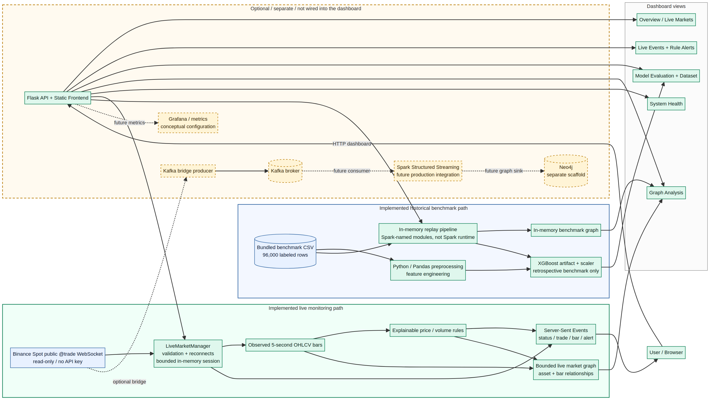

# CryptoSentinel — Live Crypto Market Monitor & Historical Benchmark

CryptoSentinel is a research prototype for monitoring cryptocurrency market activity and studying historical pump-and-dump patterns.

The application provides two separate data paths:

- **Live Markets:** Connects to Binance Spot's public WebSocket trade streams to display real-time trades, observed market bars, and explainable price/volume rule-based warnings.
- **Historical Benchmark:** Uses the bundled SystemsLab–Sapienza labeled dataset, saved XGBoost artifacts, and historical replay/evaluation tools to study previously labeled market events.

> **Important:** CryptoSentinel is a research and monitoring prototype, not a trading system or a definitive manipulation detector. Live rule-based warnings are review cues, not proof of market manipulation. The historical XGBoost model is not applied to raw Binance trades because its benchmark-specific feature schema has not been validated for live data.

---

## Table of Contents

- [Architecture](#architecture)
- [Live Dashboard](#live-dashboard)
- [Live Market Monitoring](#live-market-monitoring)
- [Rule-Based Alerts](#rule-based-alerts)
- [Historical Benchmark](#historical-benchmark)
- [Technology Stack](#technology-stack)
- [Requirements](#requirements)
- [Installation and Setup](#installation-and-setup)
- [Optional Kafka Bridge](#optional-kafka-bridge)
- [API Reference](#api-reference)
- [Project Structure](#project-structure)
- [Verification](#verification)
- [Dataset Attribution](#dataset-attribution)
- [Limitations](#limitations)

---

## Architecture

The system contains two distinct processing paths: a live market monitoring path and a historical benchmark path.

### Architecture Diagram

<!-- Replace this placeholder with your architecture diagram.
     Suggested location: docs/architecture.png -->



*The diagram should illustrate the live Binance WebSocket-to-dashboard flow and the separate historical dataset/model evaluation flow. Show Kafka as an optional component.*

---

## Live Dashboard

The dashboard provides the following sections:

- **Overview**
- **Live Markets**
- **Events**
- **Alerts**
- **Graph Analysis**
- **Model Evaluation**
- **Dataset & Benchmark**
- **System Health**

The live connection starts only when the user presses **Connect**.

The application server subscribes to a bounded list of Binance public trade streams and forwards actual received messages to the browser using Server-Sent Events (SSE).

No Binance API key, account access, trading permission, order placement, or private user data stream is required.

---

## Live Market Monitoring

For each received trade, the dashboard can display:

- Exchange trade ID
- Trading pair
- Trade price
- Base quantity
- Derived quote quantity
- Exchange event and trade timestamps
- Local receipt timestamp

Received trades are aggregated into observed, non-empty five-second bars.

A bar closes when a real trade arrives in a later time bucket. The application does not manufacture empty bars or interpolate prices.

### Live Market Graph

The live graph is bounded to the current application process session.

- Green nodes represent subscribed trading pairs.
- Smaller nodes represent observed market bars.
- Red nodes represent bars that crossed a displayed rule.
- Links represent observed pair/bar or consecutive-bar relationships.

The graph does not contain wallet addresses, ownership relationships, order-book depth, or transaction-level networks.

---

## Rule-Based Alerts

The live demonstration uses two rules on closed, observed five-second bars:

1. **Price movement:** A close-to-close price change of at least 1.0%.
2. **Volume spike:** Base volume of at least 3× the median volume of the preceding 20 observed, non-empty bars.

The volume rule remains in warm-up until the required baseline is available.

Each warning includes:

- Source bar time
- Local detection time
- Triggered rule
- Observed values

These thresholds are heuristic and are not calibrated risk probabilities. A warning does not prove pump-and-dump activity or any other form of manipulation.

There is no live XGBoost score or prediction. The saved model and its evaluation metrics are limited to the historical benchmark.

---

## Historical Benchmark

The historical research pipeline uses the bundled **SystemsLab–Sapienza Pump-and-Dump Dataset** and saved machine-learning artifacts.

The project includes:

- Historical dataset and attribution information
- Saved XGBoost model and scaler artifacts
- Historical replay and evaluation views
- Historical event and alert analysis
- Historical relationship graph functionality

Historical benchmark rows and scores are kept separate from current exchange activity.

The stored evaluation metrics describe the project's chronological historical test split only. They do not establish live-market accuracy or generalization to other exchanges, assets, periods, or manipulation strategies.

---

## Technology Stack

The project uses the following technologies and components:

| Component | Technology |
|---|---|
| Backend | Python, Flask |
| Frontend | HTML, CSS, JavaScript |
| Live market data | Binance Spot Public WebSocket |
| Browser updates | Server-Sent Events (SSE) |
| Machine learning | XGBoost |
| Historical processing | Python-based replay and evaluation |
| Optional streaming bridge | Apache Kafka |
| Testing | Python unittest, Node.js syntax checks |

**Note:** Kafka is optional. The primary live dashboard path connects directly from the public Binance WebSocket to the in-memory live manager. Kafka, Spark, Neo4j, and Grafana are not required to run the dashboard.

---

## Requirements

- Python 3.12 is recommended for the bundled model artifacts and pinned requirements.
- Internet access is required for package installation and the optional Binance public WebSocket connection.
- The dashboard runs locally using Flask.

---

## Installation and Setup

### macOS / Linux

```bash
cd crypto-manipulation-detector

python3.12 -m venv .venv
source .venv/bin/activate

python -m pip install --upgrade pip
python -m pip install -r requirements.txt

BINANCE_SYMBOLS=BTCUSDT,ETHUSDT,BNBUSDT PORT=5001 python -m backend.api.app
```

Open the dashboard:

```text
http://127.0.0.1:5001
```

Select **Connect** to start receiving actual trade messages.

The default WebSocket endpoint uses secure port 443 for networks that block port 9443. You can override it using `BINANCE_WS_BASE` if needed.

Keep the terminal window open while the application is running. Press `Ctrl+C` to stop it.

The default watchlist is BTCUSDT, ETHUSDT, and BNBUSDT. You can omit `BINANCE_SYMBOLS` to use these defaults.

### Windows PowerShell

```powershell
cd crypto-manipulation-detector

py -3.12 -m venv .venv

.\.venv\Scripts\python.exe -m pip install --upgrade pip
.\.venv\Scripts\python.exe -m pip install -r requirements.txt

$env:BINANCE_SYMBOLS = "BTCUSDT,ETHUSDT,BNBUSDT"
$env:PORT = "5001"

.\.venv\Scripts\python.exe -m backend.api.app
```

Open:

```text
http://127.0.0.1:5001
```

Press **Connect** to start live monitoring. Stop the application using `Ctrl+C`.

`BINANCE_SYMBOLS` accepts comma-separated uppercase Spot trading pair symbols. Input is validated and deduplicated server-side, with a maximum of 20 pairs.

Disconnecting or restarting clears the in-memory live session.

---

## Optional Kafka Bridge

Kafka is not required for the primary live dashboard.

If a Kafka broker is already available, the standalone bridge can forward actual public Binance trade messages to the `market_trades` topic.

```bash
KAFKA_BROKERS=localhost:9092 KAFKA_TOPIC=market_trades \
python3 backend/kafka/binance_producer.py
```

The `kafka-python` dependency is listed in `requirements.txt`.

This script does not start a Kafka broker. Configure `BINANCE_SYMBOLS` as needed.

No Spark streaming job is started by the dashboard.

---

## API Reference

### Live Session API

| Method | Endpoint | Description |
|---|---|---|
| GET | `/api/live/status` | API, connection, rule and model capability status |
| POST | `/api/live/start` | Start or replace the public stream |
| POST | `/api/live/stop` | Stop the live stream |
| GET | `/api/live/snapshot` | Bounded live trades, prices, bars, warnings and graph preview |
| GET | `/api/live/events?limit=100` | Recent validated trade messages |
| GET | `/api/live/alerts?limit=50` | Recent rule-based warnings |
| GET | `/api/live/graph?limit=300` | Bounded live market-bar graph |
| GET | `/api/live/stream` | Server-Sent Events updates |

Example request:

```json
{
  "symbols": ["BTCUSDT", "ETHUSDT"]
}
```

Send this body to `POST /api/live/start`.

### Historical Benchmark API

- `GET /api/health`
- `GET /api/stream/status`
- `POST /api/stream/start`
- `POST /api/stream/pause`
- `POST /api/stream/resume`
- `POST /api/stream/stop`
- `POST /api/stream/speed`
- `GET /api/events`
- `GET /api/events/summary`
- `GET /api/alerts`
- `GET /api/alerts/episodes`
- `POST /api/alerts/episodes/<episode-id>/acknowledge`
- `GET /api/graph/nodes`
- `GET /api/graph/suspicious`
- `GET /api/graph/stats`
- `GET /api/graph/neighbors/<node-id>`
- `GET /api/graph/asset/<symbol>`
- `GET /api/evaluation`
- `GET /api/dataset`
- `GET /api/dataset/sample?limit=6`

Live counters, events, alerts, and graph state are bounded and kept in process memory. They reset when a new live session or Flask process starts. Historical replay state remains separate.

---

## Project Structure

```text
crypto-manipulation-detector/
│
├── backend/
│   ├── api/
│   │   └── app.py
│   ├── live/
│   │   └── market_stream.py
│   ├── kafka/
│   │   └── binance_producer.py
│   └── spark/
│       └── src/
│
├── frontend/
│   ├── index.html
│   ├── live_market.js
│   ├── obsidian.css
│   └── obsidian.js
│
├── models/
├── data/
├── docs/
├── scripts/
├── screenshots/
├── tests/
│   └── test_live_market_stream.py
│
├── docker-compose.yml
├── requirements.txt
├── .gitignore
├── DELIVERY_NOTES.md
└── README.md
```

### Important Files

| File | Purpose |
|---|---|
| `backend/api/app.py` | Flask routes and dashboard serving |
| `backend/live/market_stream.py` | Public trade client, five-second bars, rule detector and bounded live state |
| `backend/kafka/binance_producer.py` | Optional Binance WebSocket-to-Kafka bridge |
| `frontend/index.html` | Live-first dashboard UI |
| `frontend/live_market.js` | Live SSE client, charts, events, alerts and graph renderers |
| `frontend/obsidian.css` | Shared responsive design system |
| `frontend/obsidian.js` | Historical benchmark UI renderers |
| `models/` | Saved model, scaler and benchmark metrics |
| `data/` | Historical benchmark dataset and attribution |
| `scripts/` | Training and evaluation utilities |
| `tests/test_live_market_stream.py` | Offline live-schema, bar and rule tests |

---

## Verification

Run the following checks from the project root.

### Python Tests

```bash
.venv/bin/python -m unittest discover -s tests -v
```

### JavaScript Syntax Check

```bash
node --check frontend/live_market.js
```

### Live API Health Check

Start the Flask application, then run:

```bash
curl http://127.0.0.1:5001/api/live/status
```

---

## Dataset Attribution

The bundled benchmark is the **SystemsLab–Sapienza Pump-and-Dump Dataset**, associated with:

M. La Morgia, A. Mei, F. Sassi, and J. Stefa,  
“Pump and Dumps in the Bitcoin Era: Real Time Detection of Cryptocurrency Market Manipulations,” ICCCN, 2020.

DOI: [10.1109/ICCCN49398.2020.9209660](https://doi.org/10.1109/ICCCN49398.2020.9209660)

Refer to `data/README.md` and `data/pump_dump_dataset/LICENSE` for source-file details and license attribution.

---

## Limitations

- Live warnings are heuristic rule-based signals, not confirmed manipulation detections.
- The saved XGBoost model is trained and evaluated against the historical benchmark, not raw live Binance trades.
- Historical benchmark metrics do not establish live-market accuracy, calibration, profitability, or generalization.
- The benchmark does not contain wallet addresses.
- The system does not prove wallet coordination, wash trading, spoofing, or current market manipulation.
- Launching the dashboard does not retrain or independently revalidate the model.
- Live session data is kept in process memory and resets when the session or Flask process restarts.

For Binance stream limits, payload definitions, lifecycle details, and implementation notes, see `docs/binance_market_stream_sources.md`.

Review current exchange terms and applicable local rules before operating a public-data client.

---

**CryptoSentinel — Research, Monitor, Analyze.**
