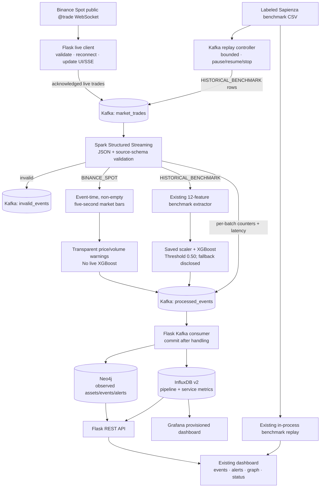

# CryptoSentinel — Live Market Monitoring & Big-Data Benchmark Pipeline

**Research prototype:** cryptocurrency market-event monitoring, historical pump-window classification, and service-backed streaming analytics.

CryptoSentinel has two clearly separated paths. A user can connect to Binance Spot's public trade WebSocket; the app validates real trades, displays observed market bars, and emits explicitly heuristic warnings. In the Docker stack, acknowledged trade messages can also enter Kafka, Spark Structured Streaming, and the API/database sinks. Historical benchmark rows can be replayed locally for evaluation or published to Kafka and scored by the same benchmark feature extractor, saved scaler, and XGBoost artifact used by the existing project.

> **Interpretation:** Live market observations and rule warnings are not proof of manipulation. The saved XGBoost model is used only for the labeled historical benchmark schema; it is not applied to raw live trades. The benchmark contains no wallet-address relationships, so the operational graph contains observed market events and assets, not wallet transactions.

## Contents

- [Architecture and data flow](#architecture-and-data-flow)
- [Implemented components](#implemented-components)
- [Run the complete stack on macOS](#run-the-complete-stack-on-macos)
- [Demonstrate event flow](#demonstrate-event-flow)
- [Grafana, InfluxDB and Neo4j](#grafana-influxdb-and-neo4j)
- [API reference](#api-reference)
- [Historical evaluation and tests](#historical-evaluation-and-tests)
- [Dataset and limitations](#dataset-and-limitations)
- [Troubleshooting](#troubleshooting)

## Architecture and data flow



### What happens to a record

1. **Source and ingress.** Start the live path from the dashboard to receive actual public Binance Spot trades, or use the bundled historical CSV. Direct local replay remains available for model evaluation without Kafka. The separate Kafka replay control publishes historical rows with `HISTORICAL_BENCHMARK` provenance to `market_trades`.
2. **Kafka.** The single-node local KRaft broker provides three explicitly created topics: `market_trades` (three partitions), `processed_events` (three), and `invalid_events` (one). JSON records carry schema version, source, event/record identifiers, timestamps and validated values. Kafka is a local demonstrator, not a replicated production cluster.
3. **Spark.** A Spark 4.2.0 Structured Streaming job reads the input topic with a durable checkpoint and bounded `maxOffsetsPerTrigger`. It validates and normalizes records, dead-letters malformed/unsupported input, and emits measured per-batch counters. Binance trades are grouped into event-time five-second bars; only real, non-empty bars are emitted. Historical rows use `backend.spark.src.preprocessing` to derive the same 12 features as the saved model, then the saved scaler and XGBoost classifier at a 0.50 probability threshold. If the model/scaler artifact is unavailable, the worker reports the reason and uses its explicitly labeled historical-only rule fallback.
4. **Live-model boundary.** Spark never applies the historical XGBoost classifier to raw live trades. Instead, after enough observed bars exist, it can produce a `RULE_WARNING` for an absolute close-to-close move of at least 1% or base volume at least 3× the median of the previous 20 observed bars. A rule warning is not a prediction or ground truth.
5. **Persistence and delivery.** The API consumer reads `processed_events` with auto-commit disabled; it commits after it has handled the batch. Processed events are retained in a bounded API-process window and upserted into Neo4j when configured. Batch metrics and periodic dependency-health measurements are written to InfluxDB. Neo4j graph endpoints return database-backed results when Neo4j is connected; the response identifies an explicitly labeled in-memory fallback otherwise.
6. **Observability.** Grafana's datasource and dashboard are provisioned from files in `backend/grafana`. The dashboard panels query the real `cryptosentinel_pipeline` and `cryptosentinel_services` measurements in the default Influx bucket. No sample/fabricated metric series are inserted. Panels remain empty until the pipeline writes data.

## Implemented components

| Component | Responsibility | Operational scope / caveat |
|---|---|---|
| Flask + existing dashboard | Live REST/SSE, historical views, service status, replay controls, database-backed graph and Influx query API | Local research app; no production authentication or authorization layer |
| Binance Spot WebSocket | Actual public trade messages, exchange timestamps, validation and reconnect | User initiated; public network/upstream required; no API key/trading permission |
| Kafka 4.1.1 (KRaft) | Broker for both real Binance trades and explicitly identified historical replay rows | Single local broker; replication factor 1 |
| Spark 4.2.0 / Scala 2.13 / Java 21 / Python | Structured Streaming validation, event-time bars, historical features/model inference, dead letters and batch metrics | Runs as `local[2]` in one container; not a multi-node Spark cluster |
| XGBoost + saved scaler | Historical benchmark binary classification (`NORMAL` vs `PUMP_AND_DUMP`) | Not a live-market classifier; threshold is 0.50 |
| Neo4j 5.26 Community | Persisted `CryptoAsset`, `MarketEvent`, `ManipulationAlert`, optional `PumpGroup` nodes and supported relationships | No wallet or transaction-address data; no wallet graph is fabricated |
| InfluxDB 2.7 | Timestamped batch/health measurements; bounded Flux query endpoint | 30-day default bucket retention; local volume persists until deliberately removed |
| Grafana 12.4 | Automatically provisioned Influx datasource and operational dashboard | Reads stored metrics; it does not infer model results itself |
| Python in-memory graph | Fallback/local historical graph and current live graph preview | Labeled as in-memory; does not imply Neo4j persistence |

## Run the complete stack on macOS

### Prerequisites

- Docker Desktop with Docker Compose v2, at least **8 GB RAM available to Docker** (12 GB is more comfortable for image builds and Spark startup), and free disk for images, model artifacts and persistent volumes.
- The pinned Docker Hub image manifests include both `linux/amd64` and `linux/arm64` variants, so the stack can run natively on Apple Silicon as well as Intel Macs.
- Internet access for pulling pinned images, the first Spark Kafka connector download, and optional Binance Spot WebSocket access.
- The bundled model artifacts and benchmark CSV; no local Java installation is needed for the Docker stack. The Spark container provides its Java 21/Python runtime.

The local image versions are pinned in Compose/Dockerfiles: Apache Kafka `4.1.1`, Apache Spark `4.2.0` (`Scala 2.13`, `Java 21`), Neo4j Community `5.26.31`, InfluxDB `2.7.12`, Grafana `12.4.2`, and Python `3.12` for Flask. The Kafka/Spark connector coordinate is `org.apache.spark:spark-sql-kafka-0-10_2.13:4.2.0`.

### Configure local-only credentials

```bash
cd /path/to/crypto-manipulation-detector-main
cp .env.example .env
```

Replace every placeholder in `.env` with unique local secrets **before starting**. For example, generate secret text with `openssl rand -hex 24` (passwords) and `openssl rand -hex 32` (Influx token); paste the outputs into the corresponding values. Keep `.env` private: it is ignored by Git. Avoid `$` in passwords because Compose uses dollar-sign interpolation. Keep the default organization and bucket names (`cryptosentinel`) unless you also adjust the provisioned Grafana queries.

### Start and stop

```bash
docker compose config --quiet       # validates configuration and required .env values
docker compose up -d --build        # builds the API, Spark, Neo4j, InfluxDB and Grafana images

docker compose ps                   # wait for broker, databases, API and Grafana health

docker compose logs -f api spark    # inspect application and processing logs
```

After configuring `.env`, `./scripts/run_pipeline.sh` performs the Compose config check, builds the images, starts the stack, and prints local UI URLs. It refuses to start if `.env` is missing or still contains the template credentials.

Open the dashboard at **http://127.0.0.1:8000**. Ports are bound to loopback by default. Use **System Health → Start Kafka replay** to publish up to 1,000 historical rows at the chosen replay speed; use **Pause / Resume / Stop** there. Use the existing benchmark replay page when you want the original in-process path. For a live-data demonstration, connect the desired pairs in **Overview/Live Markets**; live events are sent to Kafka only when the broker publisher is connected.

Stop without deleting stored data:

```bash
docker compose down
```

> `docker compose down -v` deletes the named Kafka, Neo4j, InfluxDB, Grafana and Spark-checkpoint volumes. It is intentionally **not** part of normal shutdown; use it only if you explicitly want to erase local state. Do not remove the Spark checkpoint volume while the stream is running or when you expect the same stream to resume from its checkpoint.

### Optional dashboard without Docker

The original API/dashboard and local benchmark evaluation can still run without external services:

```bash
python3.12 -m venv .venv
source .venv/bin/activate
python -m pip install --upgrade pip
python -m pip install -r requirements.txt
PORT=5001 python -m backend.api.app
```

Open **http://127.0.0.1:5001**. With no service environment variables, the health view must say `not_configured`/`unavailable`; it must not substitute fake database metrics. This optional local mode does not start Kafka or Spark.

## Demonstrate event flow

1. Start Compose and wait until `docker compose ps` reports the broker, databases, API and Grafana healthy. Spark can take longer on its first start because it downloads the version-matched Kafka connector.
2. Open System Health. Check Kafka/Spark/Neo4j/Influx/Grafana-related status and use **Start Kafka replay**. The replay controller publishes actual rows from `data/pump_dump_dataset/labeled_trades.csv`; they remain labeled historical, never live.
3. Inspect actual Kafka messages from a terminal while replay is running:

   ```bash
   docker compose exec broker /opt/kafka/bin/kafka-console-consumer.sh \
     --bootstrap-server broker:9092 --topic market_trades --from-beginning --max-messages 3
   docker compose exec broker /opt/kafka/bin/kafka-console-consumer.sh \
     --bootstrap-server broker:9092 --topic processed_events --from-beginning --max-messages 3
   ```

   Kafka retains messages, so `--from-beginning` can show earlier runs too. To inspect consumer-group offsets/lag:

   ```bash
   docker compose exec broker /opt/kafka/bin/kafka-consumer-groups.sh \
     --bootstrap-server broker:9092 --describe --group cryptosentinel-api-v1
   ```

4. The API consumer's measured counters and recent results are available at `GET /api/pipeline/status` and `GET /api/pipeline/events`. Processed historical predictions appear in the API process's bounded recent-event window and are persisted as market events/alerts in Neo4j. Influx receives batch records and service-health checks; its availability can be checked at `GET /api/metrics?range=1h`.
5. For actual live exchange data, connect Binance pairs from the dashboard. A validated trade is acknowledged by Kafka before its successful-publish counter increments. Inspect the `market_trades` topic and verify `source: BINANCE_SPOT`, `event_id`, `event_timestamp`, and `received_at`. Live Spark outputs contain heuristic rule state and leave `model_prediction`/`ground_truth` unset.

The standalone CSV replay tool `backend/kafka/csv_producer.py` remains a lower-level producer utility; the supported UI control uses the managed replay controller in `backend/integrations/service_pipeline.py` so status, pacing and stop/pause state are visible to Flask.

## Grafana, InfluxDB and Neo4j

### Grafana dashboard

Open **http://127.0.0.1:3000** and sign in with `GRAFANA_ADMIN_USER` / `GRAFANA_ADMIN_PASSWORD` from your local `.env`. Open **CryptoSentinel → CryptoSentinel · Pipeline Observability**. Its preprovisioned panels query:

- processed event counts by source;
- flagged predictions/rule warnings;
- measured batch processing latency;
- invalid, failed and dropped record counts; and
- measured dependency health (`1 = up`).

A panel can correctly show **No data** before the pipeline has written measurements or when the selected time range has no records. Grafana uses the `cryptosentinel` default bucket and the provisioned Influx token; do not paste credentials into dashboard JSON.

### InfluxDB verification

Open **http://127.0.0.1:8086** and use the initial local credentials/token from `.env`. The API query `GET /api/metrics?range=1h&limit=100` returns actual stored points or `available:false` with a reason if InfluxDB is not configured/reachable. Supported ranges are `15m`, `1h`, `6h`, `24h`, `7d`, and `30d`. Measurements:

- `cryptosentinel_pipeline`: input/processed/flagged/normal/invalid/error/dropped counts and batch latency, tagged by source and batch identifiers;
- `cryptosentinel_services`: sampled configured/up state by service (InfluxDB excludes its own health point to avoid self-report recursion).

Retention defaults to 30 days. Timestamps use UTC nanosecond precision. A real Flux query can be run in the Influx UI, for example:

```flux
from(bucket: "cryptosentinel")
  |> range(start: -1h)
  |> filter(fn: (r) => r._measurement == "cryptosentinel_pipeline"
    and r._field == "processed_events")
```

### Neo4j verification

Open **http://127.0.0.1:7474**, sign in as `neo4j` with `NEO4J_PASSWORD` from `.env`, and run read-only Cypher queries such as:

```cypher
MATCH (event:MarketEvent)-[:OBSERVED_ON]->(asset:CryptoAsset)
RETURN event.source, event.symbol, event.event_time, event.label, asset.symbol
ORDER BY event.event_time DESC LIMIT 25;

MATCH (alert:ManipulationAlert)-[:FLAGS]->(event:MarketEvent)
RETURN alert.detection_method, alert.symbol, alert.detected_at, event.record_id
ORDER BY alert.detected_at DESC LIMIT 25;
```

Writes use parameterized Cypher `MERGE` operations and startup-on-first-write constraints/indexes. Relationships describe observed events (`OBSERVED_ON`, optional benchmark `ORGANIZED_BY`, `FLAGS`); no wallet relationships are inferred. The Graph Analysis page/API reports `data_source: neo4j` when the database response is used.

## API reference

All routes are served by the Flask app on port `8000` in Compose (or the chosen `PORT` in local mode). Query integer parameters are bounded; metric time ranges are allow-listed.

| Method and path | Purpose |
|---|---|
| `GET /api/health` | Flask, dataset and saved-artifact status |
| `GET /api/pipeline/status` | Kafka, Spark, Neo4j, Influx status; replay, consumer, pipeline counters; current live status and model artifact info |
| `GET /api/metrics?range=1h&limit=500` | Query actual Influx points; supported ranges: `15m`, `1h`, `6h`, `24h`, `7d`, `30d` |
| `GET /api/pipeline/events?limit=100` | Recent records consumed from `processed_events` in this API process |
| `GET /api/pipeline/alerts?limit=100` | Recent benchmark predictions and/or live rule warnings consumed by this API process |
| `GET /api/pipeline/replay/status` | Kafka historical-replay state and sent/error counters |
| `POST /api/pipeline/replay/start` | Start Kafka CSV replay; JSON: `{"speed":100,"max_rows":1000}` |
| `POST /api/pipeline/replay/pause` · `/resume` · `/stop` | Pause, resume, or stop the Kafka replay controller |
| `GET /api/live/status` · `/snapshot` · `/events` · `/alerts` · `/graph` | Current bounded live Binance session, if started |
| `POST /api/live/start` | Start/change live pairs; JSON: `{"symbols":["BTCUSDT","ETHUSDT"]}` (up to 20) |
| `POST /api/live/stop` | Disconnect user-started public live stream |
| `GET /api/live/stream` | Server-Sent Events for live session; event types include snapshot/status/trade/bar/alert |
| `GET /api/stream/status`; `POST /api/stream/start`, `/pause`, `/resume`, `/stop`, `/speed` | Original in-process historical benchmark replay controls |
| `GET /api/events`, `/api/events/summary`; `GET /api/alerts`, `/api/alerts/episodes` | Historical in-process events and alerts |
| `GET /api/graph/nodes`, `/api/graph/suspicious`, `/api/graph/stats`, `/api/graph/neighbors/<node-id>`, `/api/graph/asset/<symbol>` | Graph data; Neo4j-backed when connected, otherwise explicitly identified local fallback |
| `GET /api/evaluation` | Stored evaluation artifact and benchmark summary |
| `GET /api/dataset`, `/api/dataset/sample?limit=6` | Dataset metadata and bounded sample preview |

The API exposes only locally bound ports in the Compose file. It is a demonstrator, not an authenticated internet-facing service. Do not publish it or its databases on an untrusted network.

## Historical evaluation and tests

`models/eval_metrics.json` contains the project's precomputed chronological benchmark evaluation (67,200 training / 14,400 validation / 14,400 test rows). Its saved test results are precision **0.9849**, recall **0.9886**, F1 **0.9868**, PR-AUC **0.9988**; confusion counts are TN 13,596, FP 12, FN 9 and TP 783. These are stored benchmark results, **not** a new end-to-end evaluation on startup and not live-market accuracy.

To retrain/recompute with the existing project script (Python environment with declared dependencies installed):

```bash
python scripts/train_models.py
# If the script refuses to overwrite existing artifacts:
python scripts/train_models.py --force
```

Run automated tests and syntax checks:

```bash
python -m unittest discover -s tests -v
python -m compileall -q backend scripts tests
node --check frontend/obsidian.js
node --check frontend/live_market.js
node --check frontend/system_health.js
```

Tests cover the actual saved-model/scaler inference function, benchmark feature dimensionality, Kafka trade serialization/acknowledgment, replay normalization, live bar warnings, unconfigured-service honesty, metrics query validation, and API status behavior. Docker service integration requires Docker Desktop; test it by starting Compose and following [Demonstrate event flow](#demonstrate-event-flow).

## Dataset and limitations

The historical benchmark is the [SystemsLab–Sapienza Pump-and-Dump Dataset](https://github.com/SystemsLab-Sapienza/pump-and-dump-dataset), associated with M. La Morgia, A. Mei, F. Sassi, and J. Stefa, “Pump and Dumps in the Bitcoin Era: Real Time Detection of Cryptocurrency Market Manipulations,” *2020 29th International Conference on Computer Communications and Networks (ICCCN)*, DOI [10.1109/ICCCN49398.2020.9209660](https://doi.org/10.1109/ICCCN49398.2020.9209660). Dataset attribution and license notices are retained under `data/`.

The saved model is a **binary benchmark pump-window versus normal** classifier. The provided labels/features do not support reliable claims that it distinguishes spoofing, wash trading, insider trading, intent, or all manipulation categories. Historical XGBoost scores do not generalize automatically to another exchange, asset, time period, or live stream. Live heuristics are inspectable review cues only.

Kafka is configured as one local broker with replication factor one; local Spark runs a single `local[2]` worker. This is a demonstrable integration, not horizontally scaled fault-tolerant infrastructure. The API consumer keeps recent events in a bounded process-local window, while Neo4j and Influx retain configured persistent data. A pipeline/API restart may reset recent API views; Spark checkpoints support streaming recovery only while its checkpoint volume and compatible query remain intact. No production authentication, TLS, secrets manager, alert delivery channel, or disaster-recovery plan is included.

## Troubleshooting

- **Compose says a variable is missing:** copy `.env.example` to `.env` and replace every required placeholder; do not leave template values in use.
- **`address already in use`:** stop the other local service using the affected loopback port (8000, 7474, 7687, 8086, 8090, 29092, or 3000), or change the left-hand host port in Compose.
- **Neo4j/InfluxDB/Grafana credentials changed after initial setup:** their initialization environment applies only to new data volumes. Use the same `.env` values that initialized the existing local volume, or deliberately reset that one service's volume after backing up anything you need. Never use `down -v` casually.
- **Spark remains unhealthy on first run:** allow the initial `spark-sql-kafka-0-10_2.13:4.2.0` download to finish and inspect `docker compose logs -f spark`. The Docker host needs adequate memory and internet access.
- **Kafka replay starts but counters do not move:** inspect `docker compose logs -f broker spark api`, confirm `market_trades`, `processed_events`, and `invalid_events` exist, and check `/api/pipeline/status` for consumer errors. A retained checkpoint resumes offsets; do not delete it unless intentionally resetting the Spark query.
- **Grafana reports no data:** run a Kafka replay or start the live source, wait for Spark and the API consumer to process output, choose a time range that includes those measurements, and check `/api/metrics?range=1h`.
- **Live feed stays disconnected:** confirm outbound access to Binance Spot WebSocket endpoints and use a valid Binance Spot pair. The dashboard reports upstream errors and reconnects with backoff; it does not simulate exchange ticks.
- **Want a completely clean local reset:** first export any data you want to preserve. `docker compose down -v` is destructive and deletes local service/checkpoint data.

## Useful source layout

```text
backend/api/app.py                         Flask UI/API routes
backend/integrations/service_pipeline.py    Kafka producers, replay controller, API consumer, health writer
backend/integrations/neo4j_store.py         Neo4j schema/upserts/graph queries
backend/integrations/influx_store.py        Influx writes and Flux read API
backend/streaming/spark_processor.py         Spark Structured Streaming + benchmark/live branches
backend/live/market_stream.py                Actual Binance Spot WebSocket client and live session
backend/spark/src/preprocessing.py            Existing benchmark feature contract
backend/grafana/provisioning/                Datasource and dashboard provider config
backend/grafana/dashboards/                  Grafana panel queries
frontend/                                    Bright dashboard pages and browser clients
models/                                      Existing trained model, scaler and evaluation artifact
data/                                        Historical benchmark and attribution
scripts/                                     Existing training utilities
```

## References

- [Binance Spot WebSocket market streams](https://developers.binance.com/en/docs/products/spot/web-sockets/market-data-streams)
- [Apache Kafka Docker image](https://hub.docker.com/r/apache/kafka)
- [Apache Spark Structured Streaming Kafka integration](https://spark.apache.org/docs/latest/streaming/structured-streaming-kafka-integration.html)
- [Neo4j Docker deployment](https://neo4j.com/docs/operations-manual/current/docker/introduction/)
- [InfluxDB Docker Compose setup](https://docs.influxdata.com/influxdb/v2/install/use-docker-compose/)
- [Grafana file provisioning](https://grafana.com/docs/grafana/latest/administration/provisioning/)
